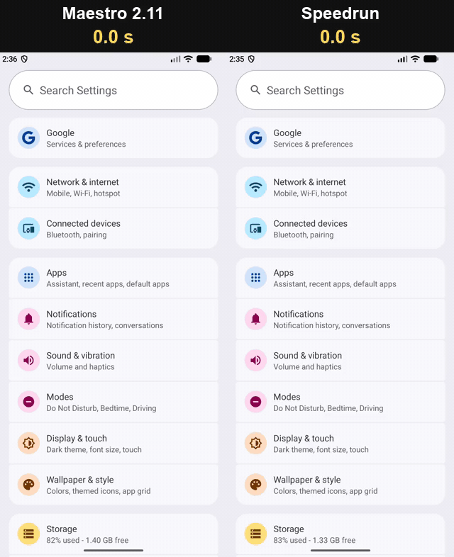
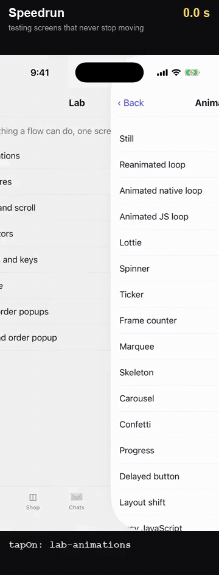

<h1 align="center">Speedrun</h1>

<p align="center">
  <b>The fastest end-to-end test runner for mobile apps.</b><br>
  Black-box UI tests for Android and iOS, written in plain YAML.
</p>

<p align="center">
  <a href="https://github.com/hubastard/speedrun/releases/latest"></a>
  
  <a href="LICENSE"></a>
</p>

<p align="center">
  <br>
  <sub>The same 15-step test of Android's Settings app (<a href="bench/settings/bench_scenario_android.yaml">flow</a>) on one emulator, in real time.</sub>
</p>

---

Speedrun tests your app the way a user uses it: it taps, types, scrolls and checks what is on
screen, from outside the app, with nothing added to it. A test is a short YAML file:

```yaml
appId: com.example.app
---
- launchApp
- tapOn: "Sign in"
- inputText: "user@example.com"
- tapOn: "Continue"
- assertVisible: "Welcome"
```

## Why Speedrun?

- **Fast.** A tap that opens a screen takes about 0.3 s, and a run starts in 1–3 s. The same
  user journey takes 20 s with Speedrun on Android, 59 s with Appium, 66 s with
  maestro-runner and 127 s with Maestro ([benchmark](#benchmark)).
- **Waits for the app, not the clock.** Each step starts the moment the app has finished
  changing: no sleeps, no comparing screenshots. Screens that never stop moving (spinners,
  tickers, carousels) don't hold it up.
- **Fewer flaky failures.** It doesn't tap a popup that is still sliding in or a button behind
  a loading overlay, and it scrolls an element out from under a sticky footer or the keyboard
  before tapping it, so the same flow passes on a small phone.
- **Black-box.** Any build of your app, release builds included, through the platform's
  accessibility layer. Tested on native and React Native apps.
- **One download.** A single binary and its iOS agent: no JVM, no drivers to install, no SDK
  in your app.
- **Ready for CI.** JUnit and HTML reports, sharding across devices, tags, and a debug folder
  with screenshots and logs for every failure. It answers the "isn't responding" dialogs a
  freshly booted emulator puts up, and reconnects to its agent if the agent crashes.

## Quick start

1. **Install:**

   ```sh
   curl -fsSL https://raw.githubusercontent.com/hubastard/speedrun/main/install.sh | bash
   ```

   It installs the latest release in `~/.speedrun` and adds it to your PATH
   (`SPEEDRUN_VERSION=v0.1.7` picks a release). Or download the archive from the
   [releases](https://github.com/hubastard/speedrun/releases) and keep its `agent/` folder next
   to the binary. To build it yourself, see [Building from source](#building-from-source).
   Later, `speedrun update` installs the newest release in its place.

2. **Write a flow** ([how](docs/flows.md)), or use the ones you have:

   ```yaml
   # login.yaml
   appId: com.example.app
   ---
   - launchApp:
       clearState: true
   - tapOn: "Email"
   - inputText: "user@example.com"
   - tapOn: "Password"
   - inputText: ${PASSWORD}
   - tapOn: "Sign in"
   - assertVisible: "Welcome"
   ```

3. **Run it** on a running Android emulator or device, or a booted iOS simulator:

   ```sh
   speedrun test login.yaml -e PASSWORD=secret                  # Android
   speedrun test -p ios login.yaml -e PASSWORD=secret           # iOS simulator
   speedrun test flows/ --format junit --output report.xml      # a whole suite, for CI
   ```

In a terminal you see each step live, with its time. When a step fails, Speedrun shows what
was on screen, and where it saved the screenshot and logs.

## Already using Maestro?

Speedrun reads the [Maestro](https://maestro.dev) flow format: your flow files, `config.yaml`,
tags, environment variables and scripts run as they are, and `speedrun test` takes the same
options as `maestro test` and writes the same reports. Switching is a one-word change:

```sh
maestro test flows/     # before
speedrun test flows/    # after
```

Everything runs as written except Maestro's AI commands (`assertWithAI` and the like). The
details, and the few differences you may notice:
[Maestro compatibility](docs/maestro-compatibility.md).

## Explore an app with an AI agent

A session keeps Speedrun connected to the device between commands, so an AI coding agent can
drive the app a step at a time, read the screen in a few lines, and save the steps that worked
as a flow for CI:

```sh
speedrun session start --app com.example.app
speedrun look                          # @5 Field #email, @7 Button "Sign in" ...
speedrun do 'tapOn: @5' 'inputText: "user@example.com"' 'tapOn: @7'
speedrun session save flows/sign-in.yaml
```

Each answer says how each command went and what changed on screen, in a few lines: an agent
pays a few hundred tokens per step, not a whole accessibility tree. See
[Sessions](docs/sessions.md), and [the comparison with other agent tools](#for-ai-agents).

### As an MCP server

`speedrun mcp` serves the same as [Model Context Protocol](https://modelcontextprotocol.io)
tools (`session_start`, `look`, `run`, `save_flow`...), for agents that take tools from MCP
servers. With [Claude Code](https://claude.com/claude-code), after installing Speedrun:

```sh
claude mcp add speedrun -- ~/.speedrun/speedrun mcp              # this project
claude mcp add --scope user speedrun -- ~/.speedrun/speedrun mcp # every project
```

Other MCP clients (Claude Desktop, Cursor, ...) take a server in their JSON configuration:

```json
{
  "mcpServers": {
    "speedrun": { "command": "/Users/you/.speedrun/speedrun", "args": ["mcp"] }
  }
}
```

Use the binary's full path: an MCP client may not start servers with your shell's PATH. Then start an emulator or simulator and ask the agent to test something like: 
```
Start a speedrun session for com.example.app, sign in as user@example.com, and save the flow to flows/sign-in.yaml
````

## Built against an app made to be hard to test

Speedrun is developed against [Speedrun Bench](bench/app), a React Native app built to trip up
UI test tools: screens that never stop moving (looping Lottie and Reanimated animations,
tickers, marquees, shimmering skeletons, carousels that page on their own), a button that
turns on late, a banner that shifts the layout, a loading overlay over a keypad, popups that
arrive late or one after another, the keyboard over the checkout button, lists that load
more as you scroll, native alerts and permission prompts. Its 19 flows cover every command
and selector, and are Speedrun's regression suite on Android and iOS; a journey through the
app also runs on GitHub Actions' emulator and simulator after every push.

<p align="center">
  <br>
  <sub>Six of those screens on the iOS simulator, in real time, with animations at their normal speed: Speedrun taps each screen's button three times while it moves, then checks the count. No sleeps.</sub>
</p>

Waiting for a still screen would never end on such an app. Speedrun waits until what it acts
on has settled and leaves endless animations out of that check; it also waits for a disabled
button to turn on, a loading overlay to go and a popup to finish sliding in before it taps.

## Benchmark

Speedrun Bench's 19 flows, run by Speedrun and Maestro from the same files:

| | Speedrun | Maestro 2.11 | Speedrun is |
|---|---|---|---|
| **Android emulator**, whole suite | **7 min 9 s**, 19/19 passed | 46 min 56 s, 16/19 passed | |
| on the 16 flows both pass | 6 min 17 s | 43 min 58 s | **7.0x faster** |
| **iOS simulator**, whole suite | **9 min 59 s**, 19/19 passed | 40 min 19 s, 8/19 passed | |
| on the 8 flows both pass | 2 min 35 s | 7 min 42 s | **3.0x faster** |

Maestro's time for a flow it fails stops at the failure. Estimating the whole suite as if it
had finished those flows, Speedrun is about 6.7x faster on Android and 4.5x on iOS. On native
screens, the system Settings app ([`bench/settings`](bench/settings)), Speedrun is 10.7x
faster on Android and 2.9x on iOS.

Measured on an Apple M1 Pro (16 GB), with an Android 17 emulator and an iPhone 17 Pro
simulator (iOS 26.2): Speedrun's current code on 2026-10-28, the other tools on 2026-10-27
(they have not changed since). Speedrun's iOS numbers are with `SPEEDRUN_REDUCE_MOTION=1`
(the simulator's Reduce Motion on during the run); without it this suite runs about 10%
slower. Per-flow results, why Maestro failed, and how to rerun it all:
[bench/app](bench/app/README.md).

### Against other black-box tools

One user journey on Speedrun Bench (sign in with a code, search the shop and fill a cart, set
a PIN under a loading overlay, scroll a long list), written for each tool the way its tests
are usually written: [bench/journey](bench/journey). Each tool ran it three times after a
warm-up; the time is the median of its passing runs, its start-up included.

| Tool | Android emulator | iOS simulator |
|---|---:|---:|
| **Speedrun** | **20.4 s**, 3/3 passed | **28.4 s**, 3/3 passed |
| Appium 3.9 | 59.4 s, 3/3 passed | 94.1 s, 3/3 passed |
| [maestro-runner](https://github.com/devicelab-dev/maestro-runner) 1.1.29 | 65.9 s, 2/3 passed | 49.6 s, 3/3 passed |
| XCUITest | | 81.2 s, 3/3 passed |
| Maestro 2.11 | 126.5 s, 2/3 passed | 113.1 s, 2/3 passed |

Speedrun runs the journey 2.9x faster than Appium on Android and 3.3x on iOS, 3.2x (Android)
and 1.7x (iOS) faster than maestro-runner, 2.9x faster than XCUITest, and 6.2x (Android) and
4.0x (iOS) faster than Maestro. Speedrun and maestro-runner ran on 2026-10-28, the others on
2026-10-27, on the same machine; Speedrun on iOS with `SPEEDRUN_REDUCE_MOTION=1` (29.7 s
without).

It also passed every run, as it passes all 19 flows of the app's test suite on both
platforms. Maestro failed one journey run on each platform (a tap lost on the product page on
iOS, the long-list scroll out of time on Android) and 3 of the suite's 19 flows on Android, 11
on iOS; maestro-runner's long-list scroll ran out of time in one Android run. The journey leaves out one step of the suite that the other tools could not pass
reliably: tapping a checkbox right after scrolling to it, a tap Maestro lost in all 4 of its
iOS runs and XCUITest in 1 of 4.

### For AI agents

The steps an agent takes to try out a feature of Speedrun Bench (launch it, skip the
onboarding, search the shop, open a product, check what shows), driven through each agent
tool's command line with the loop its documentation recommends, the calls scripted rather
than chosen by a model: [bench/agents](bench/agents). The time is the median of three runs
after a warm-up; the tokens are what the tool printed, which the agent reads (estimated as
characters / 4).

| Tool | Android emulator | iOS simulator |
|---|---:|---:|
| **Speedrun** (`speedrun session`) | **4.2 s**, ~1,560 tokens | **12.0 s**, ~1,230 tokens |
| [agent-device](https://github.com/callstackincubator/agent-device) 0.21 | 9.1 s, ~2,240 tokens | 14.0 s, ~1,620 tokens |
| [Argent](https://github.com/software-mansion/argent) 0.31 | 11.7 s, ~3,630 tokens | 12.2 s, ~2,650 tokens |

Every run passed. Argent reads the whole screen to find what to tap, and through its MCP server
also attaches a screenshot after each action, which this leaves out.

## How it works

Speedrun runs a small agent on the device. It reads the screen in milliseconds, without
screenshots, and tells exactly when the app has settled, so each step starts the moment the
app is ready instead of after a fixed wait.

## Requirements

- **macOS** on Apple silicon, for Android and iOS, or **Linux** x86_64, for Android (CI
  runners included). The install script picks the right package.
- **Android:** the platform tools (`adb` on your PATH) and a running emulator, or a device
  with USB debugging on.
- **iOS:** Xcode and a booted simulator. Real iOS devices are not supported yet. A release's
  iOS agent is built with one Xcode (its `README.txt` names it); with a much different Xcode,
  build from source.
- `curl`, for flow scripts that make HTTP requests.

## Documentation

- [Writing flows](docs/flows.md): a flow's steps, finding elements, every command, for
  someone new to the format.
- [Command line](docs/cli.md): options, environment variables, exit status.
- [Sessions](docs/sessions.md): drive an app a command at a time, from an AI agent or a
  terminal, and save the steps as a flow.
- [Maestro compatibility](docs/maestro-compatibility.md): what is supported, and the
  differences you may notice.
- [Troubleshooting](docs/troubleshooting.md).
- [Benchmark](bench/app/README.md): the app, its flows, per-flow results.

## Building from source

You need JDK 17, the [Odin](https://odin-lang.org) compiler and a C compiler (`cc`), plus
Xcode for iOS support.

```sh
git clone https://github.com/hubastard/speedrun.git
cd speedrun
./build.sh      # builds ./speedrun (Android support only without Xcode)
./package.sh    # optional: a release archive in dist/
```

For iOS only, without a JDK: `SPEEDRUN_NO_ANDROID=1 ./build.sh`.

How Speedrun works inside: [DEVELOPMENT.md](DEVELOPMENT.md). What is still slow:
[TO_IMPROVE.md](TO_IMPROVE.md).

## Status

Speedrun is young and changes fast. If a flow that passes with Maestro fails with Speedrun,
please open an issue with the flow and the output of `SPEEDRUN_DEBUG=1 speedrun test …`.

## License

Speedrun is licensed under the [Apache License 2.0](LICENSE). It includes
[QuickJS-ng](https://github.com/quickjs-ng/quickjs) (MIT),
[Datafaker](https://github.com/datafaker-net/datafaker)'s English word lists (Apache-2.0) and
[stb_image](https://github.com/nothings/stb) (public domain or MIT): see [NOTICE](NOTICE).
