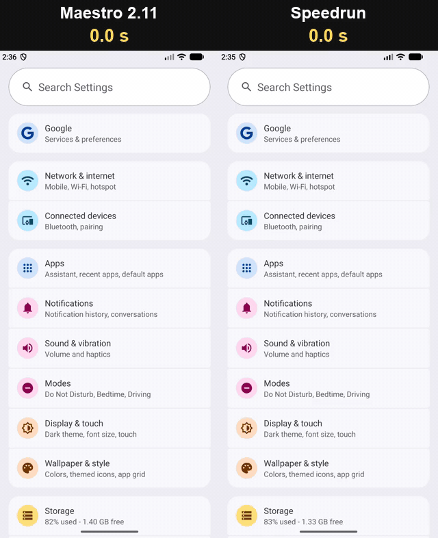
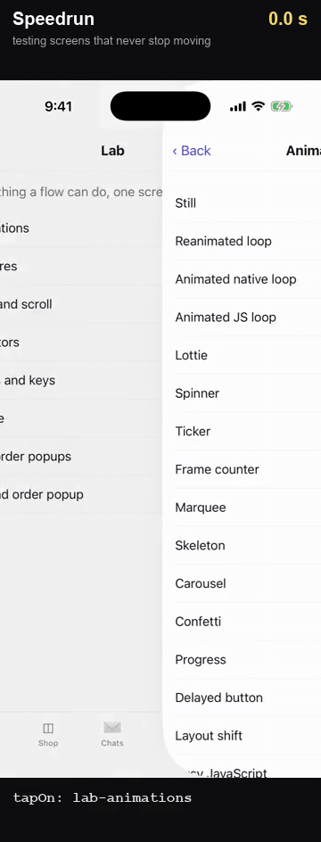

<h1 align="center">Speedrun</h1>

<p align="center">
  <b>The fastest end-to-end test runner for mobile apps and the web.</b><br>
  Black-box UI tests for Android, iOS and the web, written in plain YAML.
</p>

<p align="center">
  <a href="https://github.com/hubastard/speedrun/releases/latest"></a>
  
  <a href="LICENSE"></a>
</p>

<p align="center">
  <br>
  <sub>The same 15-step test of Android's Settings app (<a href="bench/settings/bench_scenario_android.yaml">flow</a>) on one emulator, in real time.</sub>
</p>

---

Speedrun tests your app the way a user uses it: it taps, types, scrolls and checks what is on
screen, from outside the app, with nothing added to it. A test is a short YAML file:

```yaml
appId: com.example.app
---
- launchApp
- tapOn: "Sign in"
- inputText: "user@example.com"
- tapOn: "Continue"
- assertVisible: "Welcome"
```

## Why Speedrun?

- **Fast.** A tap that opens a screen takes about 0.3 s, and a run starts in 1–3 s. The same
  user journey takes 20 s with Speedrun on Android, 59 s with Appium, 66 s with
  maestro-runner and 127 s with Maestro. In the browser, Cypress's own demo app's tests take
  4.2 s with Speedrun, 5.9 s with Playwright and 11.3 s with Cypress ([benchmark](#benchmark)).
- **Waits for the app, not the clock.** Each step starts the moment the app has finished
  changing: no sleeps, no comparing screenshots. Screens that never stop moving (spinners,
  tickers, carousels) don't hold it up.
- **Fewer flaky failures.** It doesn't tap a popup that is still sliding in or a button behind
  a loading overlay, and it scrolls an element out from under a sticky footer or the keyboard
  before tapping it, so the same flow passes on a small phone.
- **Black-box.** Any build of your app, release builds included, through the platform's
  accessibility layer. Tested on native and React Native apps.
- **One file.** The Android and iOS agents are built in, and it drives Chrome itself: no JVM,
  no WebDriver or drivers to install, no SDK in your app.
- **Ready for CI.** JUnit and HTML reports, sharding across devices, tags, and a debug folder
  with screenshots and logs for every failure. It answers the "isn't responding" dialogs a
  freshly booted emulator puts up, reconnects to its agent if the agent crashes, and boots iOS
  simulators without the background services that slow a runner's first minutes
  ([Running on CI](#running-on-ci)).

## Quick start

1. **Install** with Homebrew (macOS on Apple silicon, Linux x86_64):

   ```sh
   brew install hubastard/tap/speedrun
   ```

   Or with the install script:

   ```sh
   curl -fsSL https://raw.githubusercontent.com/hubastard/speedrun/main/install.sh | bash
   ```

   Other ways to install, updating, and building from source: [Install](docs/install.md).

2. **Write a flow** ([how](docs/flows.md)), or use the ones you have:

   ```yaml
   # login.yaml
   appId: com.example.app
   ---
   - launchApp:
       clearState: true
   - tapOn: "Email"
   - inputText: "user@example.com"
   - tapOn: "Password"
   - inputText: ${PASSWORD}
   - tapOn: "Sign in"
   - assertVisible: "Welcome"
   ```

3. **Run it** on a running Android emulator or device, or a booted iOS simulator:

   ```sh
   speedrun test login.yaml -e PASSWORD=secret                  # Android
   speedrun test -p ios login.yaml -e PASSWORD=secret           # iOS simulator
   speedrun test flows/ --format junit --output report.xml      # a whole suite, for CI
   ```

   A website's flow names its page with `url:` instead of `appId:`, and runs in Chrome:
   `speedrun test --headless web-login.yaml` ([Web](docs/web.md)).

In a terminal you see each step live, with its time. When a step fails, Speedrun shows what
was on screen, and where it saved the screenshot and logs.

## Already using Maestro?

Speedrun reads the [Maestro](https://maestro.dev) flow format: your flow files, `config.yaml`,
tags, environment variables and scripts run as they are, and `speedrun test` takes the same
options as `maestro test` and writes the same reports. Switching is a one-word change:

```sh
maestro test flows/     # before
speedrun test flows/    # after
```

Everything runs as written, web flows included, except Maestro's AI commands (`assertWithAI`
and the like) and `startRecording` on the web. The details, and the few differences you may
notice:
[Maestro compatibility](docs/maestro-compatibility.md).

## Running on CI

```sh
speedrun fast-boot --device "$UDID"   # iOS: boots the simulator without the services tests do not use
speedrun test flows/ --format junit --output report.xml --debug-output debug --flatten-debug-output
```

On a CI runner's first boot, an iOS simulator's background services (Siri, Spotlight's
indexing, iCloud syncing and more) take the CPU your tests need for minutes. `speedrun fast-boot`
turns them off and boots the simulator: use it in place of `xcrun simctl boot`. Speedrun's own
iOS CI job went from about 10 minutes to about 6, with one more flow than before.

Reports, sharding, what to keep from a failed run, and booting the simulator while your app
builds: [Running on CI](docs/ci.md).

## Explore an app with an AI agent

A session keeps Speedrun connected to the device between commands, so an AI coding agent can
drive the app a step at a time, read the screen in a few lines, and save the steps that worked
as a flow for CI:

```sh
speedrun session start --app com.example.app
speedrun look                          # @5 Field #email, @7 Button "Sign in" ...
speedrun do 'tapOn: @5' 'inputText: "user@example.com"' 'tapOn: @7'
speedrun session save flows/sign-in.yaml
```

Each answer says how each command went and what changed on screen: an agent pays a few
hundred tokens per step, not a whole accessibility tree. `speedrun mcp` serves the same as
[MCP](https://modelcontextprotocol.io) tools; with [Claude Code](https://claude.com/claude-code):

```sh
claude mcp add speedrun -- ~/.speedrun/speedrun mcp
```

Other MCP clients, and every command: [Sessions](docs/sessions.md).

## Benchmark

Speedrun is developed against [Speedrun Bench](bench/app), a React Native app built to trip up
UI test tools: screens that never stop moving, a button that turns on late, a loading overlay
over a keypad, popups that arrive late, the keyboard over the checkout button, native alerts
and permission prompts. Its 19 flows are Speedrun's regression suite on Android and iOS, and a
journey through the app runs on GitHub Actions' emulator and simulator after every push.

<p align="center">
  <br>
  <sub>Six of those screens on the iOS simulator, in real time, with animations at their normal speed: Speedrun taps each screen's button three times while it moves, then checks the count. No sleeps.</sub>
</p>

One user journey on it (sign in with a code, fill a cart, set a PIN under a loading overlay,
scroll a long list), written for each tool the way its tests are usually written. The median
of three runs after a warm-up, start-up included ([bench/journey](bench/journey)):

| Tool | Android emulator | iOS simulator |
|---|---:|---:|
| **Speedrun** | **20.3 s**, 3/3 passed | **25.5 s**, 3/3 passed |
| Appium 3.9 | 59.4 s, 3/3 passed | 94.1 s, 3/3 passed |
| [maestro-runner](https://github.com/devicelab-dev/maestro-runner) 1.1.29 | 65.9 s, 2/3 passed | 49.6 s, 3/3 passed |
| [Argent](https://github.com/software-mansion/argent) 0.31 (`argent e2e`) | 81.5 s, 3/3 passed | 72.2 s, 3/3 passed |
| XCUITest | | 81.2 s, 3/3 passed |
| Maestro 2.11 | 126.5 s, 2/3 passed | 113.1 s, 2/3 passed |

- **Against Maestro, from the same flow files:** Speedrun passes all 19 of the app's flows on
  both platforms, Maestro 16 on Android and 8 on iOS. On the flows both pass, Speedrun is 8.7x
  faster on Android and 3.0x on iOS ([bench/app](bench/app/README.md)); on the system
  Settings app ([bench/settings](bench/settings)), 10.7x and 2.9x.
- **For AI agents**, trying out a feature through each tool's MCP server: Speedrun took 4.5 s
  on Android and 7.8 s on iOS, [agent-device](https://github.com/callstackincubator/agent-device)
  8.2 s and 12.5 s, [Argent](https://github.com/software-mansion/argent) 13.0 s and 11.8 s,
  and Speedrun's answers cost the agent the fewest tokens ([bench/agents](bench/agents)).

**On the web**, the same tests written for each tool, the median of three runs after a warm-up,
start-up included ([bench/web](bench/web)): Playwright's TodoMVC demo, and seven tests from
the suite of Cypress's [Real World App](https://github.com/cypress-io/cypress-realworld-app),
a payments app in React and Material UI:

| Tool | TodoMVC | Real World App, 7 tests |
|---|---:|---:|
| **Speedrun** | **0.66 s**, passed | **4.2 s**, 7/7 passed |
| Playwright 1.64 | 1.30 s, passed | 5.9 s, 7/7 passed |
| Cypress 16.1 | 3.66 s, passed | 11.3 s, 7/7 passed |
| Maestro 2.11 | failed | 3/6 passed in 30 min, then stopped |

Every tool ran a headless Chromium browser (Cypress its default, Electron), at the same window
size, one test at a time, with its default settings. Playwright's `fill` puts a field's text in at once,
while Speedrun types it a key at a time.

Measured on an Apple M1 Pro with an Android 17 emulator and an iPhone 17 Pro simulator (iOS
26.2), in October 2026 (the web: November 2026), each tool as it ships. On iOS that means
Speedrun runs the app's animations 10x faster, as it does by default, and the other tools at
normal speed; with the agent tools all at normal speed, on iOS Speedrun took 11.3 s,
agent-device 12.5 s and Argent 11.8 s. Speedrun's iOS suite and journey runs also had the
simulator's Reduce Motion on (`--animations off`; the journey took 26.6 s without it).

## How it works

Speedrun runs a small agent on the device. It reads the screen in milliseconds, without
screenshots, and tells exactly when the app has settled, so each step starts the moment the
app is ready instead of after a fixed wait. In the browser, a script in the page does the same,
from what the page reports: its changes, requests in flight, timers and animations.

## Requirements

- **macOS** on Apple silicon, for Android, iOS and web, or **Linux** x86_64, for Android and
  web (CI runners included). The install script picks the right package.
- **Android:** the platform tools (`adb` on your PATH) and a running emulator, or a device
  with USB debugging on.
- **Web:** Chrome. Speedrun uses the one installed, or downloads Chrome for Testing on the
  first run ([Web](docs/web.md#chrome)); macOS or Linux.
- **iOS:** Xcode and a booted simulator (on CI, boot it with
  [`speedrun fast-boot`](docs/ci.md#ios-boot-the-simulator-with-speedrun-fast-boot)). Real iOS devices
  are not supported yet. A release's iOS agent is built with one Xcode (its release notes name
  it); with a much different Xcode, [build from source](docs/install.md#building-from-source).
- `curl`, for flow scripts that make HTTP requests.

## Documentation

- [Install](docs/install.md): Homebrew, the install script, updates, building from source.
- [Writing flows](docs/flows.md): a flow's steps, finding elements, every command, for
  someone new to the format.
- [Command line](docs/cli.md): options, environment variables, exit status.
- [Running on CI](docs/ci.md): reports, sharding, failure artifacts, `speedrun fast-boot` for
  iOS simulators.
- [Web](docs/web.md): testing websites in Chrome, with the same flows.
- [Sessions](docs/sessions.md): drive an app a command at a time, from an AI agent or a
  terminal, and save the steps as a flow.
- [Maestro compatibility](docs/maestro-compatibility.md): what is supported, and the
  differences you may notice.
- [Troubleshooting](docs/troubleshooting.md).
- Benchmarks: [the app and its flows](bench/app/README.md), [the journey against other
  tools](bench/journey), [agent tools](bench/agents), [the web](bench/web).

## Status

Speedrun is young and changes fast. If a flow that passes with Maestro fails with Speedrun,
please open an issue with the flow and its folder in the debug output (`logs/debug.log` there
traces the run), or the output of `SPEEDRUN_DEBUG=1 speedrun test …`.

## License

Speedrun is licensed under the [Apache License 2.0](LICENSE). It includes
[QuickJS-ng](https://github.com/quickjs-ng/quickjs) (MIT),
[Datafaker](https://github.com/datafaker-net/datafaker)'s English word lists (Apache-2.0) and
[stb_image](https://github.com/nothings/stb) (public domain or MIT): see [NOTICE](NOTICE).
